<h1 align="center">Grounded Copilot</h1>

<p align="center">
  <em>A retrieval-augmented copilot that answers only from its sources, with inline citations, an abstention guardrail when retrieval is weak, and a faithfulness check that verifies every claim traces back to a cited passage.</em>
</p>

<p align="center">
  <a href="https://github.com/adeoluo/grounded-copilot/actions/workflows/ci.yml"></a>
  
  
  
  
  
</p>

---

## Motivation

The failure mode of a retrieval-augmented assistant is a confident answer that is not actually
supported by its sources, or an answer to a question the corpus cannot address. A trustworthy
copilot does three things: it **cites** the passage behind every claim, it **abstains** when
retrieval does not surface relevant context, and it is **checked for faithfulness** so unsupported
answers are caught rather than shipped. This project implements that copilot from scratch, with
**zero runtime dependencies**: a TF-IDF retriever, an abstention threshold on retrieval score, inline
citations, and a sentence-level faithfulness metric.

The model sits behind a provider interface. An offline composer that answers strictly from the
retrieved passages powers tests and CI, so everything is reproducible without credentials; a **real
Claude provider**, built on the standard library, powers production.

## Architecture

<p align="center">
  
</p>

A question retrieves the top passages; if the best score is below the abstention threshold the
copilot declines; otherwise the numbered passages and the question become a prompt, the provider
returns an answer with citations, and a faithfulness check verifies each answer sentence against the
passages it cites. See the [ADRs](docs/adr/) for the key decisions.

## What it implements

- **TF-IDF retrieval** from scratch over a corpus of passages, with stop-word filtering so relevance
  reflects content words, not function words.
- **An abstention guardrail** - when the top retrieval score is below a threshold, the copilot says
  it does not have enough information rather than guessing.
- **Inline citations** - every answer carries the passage numbers it draws from, resolved to source
  names.
- **A faithfulness metric** - the fraction of answer sentences whose content is supported by a cited
  passage, so an ungrounded answer scores low.

## Results

> Reproduce with `python -m grounded_copilot evaluate`. The benchmark labels each question as
> answerable from the corpus or out of scope.
>
> These numbers come from the deterministic offline composer and are reproduced by the test suite in continuous integration (no network, no credentials). In production the provider is Claude behind the same interface; the abstention guardrail and faithfulness check apply to its answers exactly as they do here.

| Metric (10-question benchmark) | Value |
|---|---:|
| **abstention accuracy** | **1.000** |
| **mean faithfulness** | **1.000** |
| **citation coverage** | **1.000** |

The copilot answers every answerable question and abstains on every out-of-scope one (**abstention
accuracy 1.0**), every answer it gives is fully supported by its citations (**faithfulness 1.0**),
and every answer carries a citation (**citation coverage 1.0**). The faithfulness metric is not
decorative: a test drives a deliberately hallucinating provider and the score drops below 0.5,
showing the check catches unsupported claims.

### Scale

`benchmarks/scale.py` answers a fixed 100-question set (60 answerable, 40 deliberately
out of scope) against progressively larger synthetic knowledge bases, reporting
wall-clock time, question throughput, peak memory (stdlib `tracemalloc`, measured in a
separate pass), and abstention accuracy. Measured on this machine (`uv run python
benchmarks/scale.py`):

| Passages | Seconds | Questions/sec | Peak MiB | Abstention accuracy |
|---:|---:|---:|---:|---:|
| 200 | 0.06 | 1,806 | 0.2 | 1.00 |
| 500 | 0.17 | 599 | 0.6 | 1.00 |
| 1,000 | 0.22 | 451 | 1.2 | 1.00 |
| 2,000 | 0.36 | 276 | 2.4 | 1.00 |

The guardrails hold as the corpus grows -- abstention accuracy stays 1.00 (and mean
faithfulness and citation coverage stay 1.00 for the same reason: every answer is a
sentence lifted from a cited passage) -- while throughput falls because the from-scratch
TF-IDF retriever scores every passage per query. These numbers are from synthetic data on
a pure-Python pipeline with the deterministic offline provider; they are **not** a
comparison against production vector databases or frameworks, which would be far faster
and are the right tool at real scale.

## Demonstration

```text
$ python -m grounded_copilot ask "Why is Mars called the red planet?"
answer: Mars is known as the red planet because iron oxide on its surface gives it a reddish appearance. [1]
sources: solar-system.md
faithfulness: 1.000  retrieval score: 0.374

$ python -m grounded_copilot ask "What is the capital of France?"
[abstained, retrieval score 0.0]
  I do not have enough information in the provided sources to answer that.
```

## Using a real model in production

```python
from grounded_copilot import Copilot, AnthropicProvider

copilot = Copilot(provider=AnthropicProvider())  # reads ANTHROPIC_API_KEY
answer = copilot.answer("What does photosynthesis produce?")
print(answer.text, answer.sources, answer.faithfulness.score)
```

The `AnthropicProvider` calls the Claude Messages API over HTTPS using only the standard library, so
there is no third-party runtime dependency. The abstention and faithfulness checks apply to its
answers exactly as they do to the offline composer.

## Quickstart

```bash
git clone https://github.com/adeoluo/grounded-copilot.git && cd grounded-copilot
make setup                      # install dev tooling + pre-commit hooks
make all                        # lint + type-check + test

python -m grounded_copilot evaluate                        # abstention, faithfulness, citations
python -m grounded_copilot ask "What is the deepest ocean?"  # a grounded answer
python -m grounded_copilot ask "Who painted the Mona Lisa?"   # an abstention
python -m grounded_copilot serve                           # start the HTTP service on :8000
```

## HTTP service

A standard-library HTTP service answers questions from the corpus. The routing logic is a pure
function, tested without a socket. Under a concurrent stress benchmark
(`uv run python benchmarks/stress.py`, 5000 requests, 8 workers) the `/ask` handler sustains roughly
**4,100 requests/second** at **p50 0.16 ms** with the offline provider.

| Method | Path | Purpose |
|---|---|---|
| GET | `/health` | liveness, the active provider, and the corpus size |
| GET | `/ready` | readiness |
| GET | `/metrics` | per-route request, error, and latency metrics (Prometheus text) |
| POST | `/ask` | body `{"question": str}`; a grounded answer with citations or an abstention |
| GET | `/evaluate` | abstention accuracy, faithfulness, and citation coverage on the benchmark |

## Design decisions

- **Abstain on weak retrieval** - a retrieval-score threshold is a simple, honest gate that keeps the
  copilot from answering what its corpus cannot support. See [ADR 0002](docs/adr/0002-abstention.md).
- **Measure faithfulness per sentence** - checking each answer sentence against its cited passages
  turns "is this grounded" into a number the pipeline reports. See
  [ADR 0003](docs/adr/0003-faithfulness.md).

## Evaluation

The corpus, retriever, and offline composer are deterministic, so every number reproduces offline.
Full method and tables: [`docs/EVALUATION_REPORT.md`](docs/EVALUATION_REPORT.md).

## Responsible AI

- **Model card:** [`docs/MODEL_CARD.md`](docs/MODEL_CARD.md)
- **Data card:** [`docs/DATA_CARD.md`](docs/DATA_CARD.md)
- **Threat model:** [`docs/THREAT_MODEL.md`](docs/THREAT_MODEL.md)

## Limitations

- Retrieval is TF-IDF, which matches on words, not meaning; a question phrased with different words
  than the source may retrieve weakly and trigger abstention. An embedding retriever would help.
- The faithfulness metric uses content-word overlap, a proxy for entailment; it catches blatant
  hallucination but is not a natural-language inference model.
- The corpus is small and fixed; a real deployment would index a larger, updating document set.

## Roadmap

- [ ] Add an embedding retriever for paraphrase-robust recall.
- [ ] Replace overlap-based faithfulness with a natural-language-inference check.
- [ ] Support multi-passage answers with per-sentence citations.

## License

[MIT](LICENSE)
